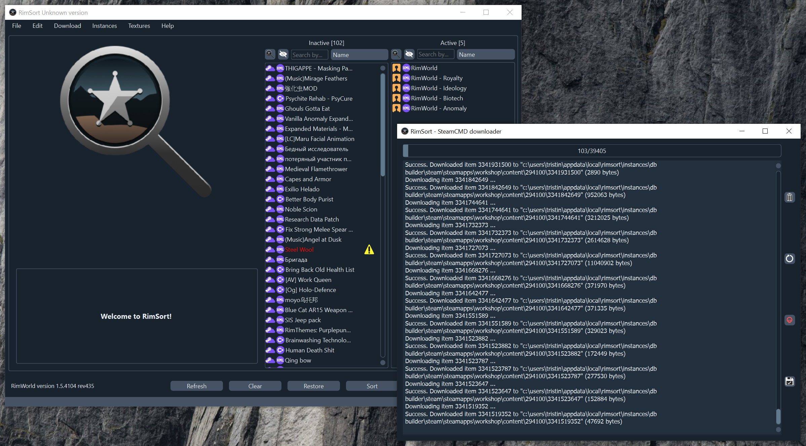

<p align="center">
    <h1 align="center">RimSort</h1>
    <p align="center">A free and open source multi-platform mod manager for the video game RimWorld.<br>
    Built from the ground up to be reliable and community managed.<br>
    Includes support for Linux, Mac, and Windows.</p>
    <p align="center"><strong><a href="https://github.com/RimSort/RimSort/releases">Releases</a> | <a href="https://rimsort.github.io/RimSort/">Wiki</a> | <a href="https://discord.gg/aV7g69JmR2">Discord</a></strong> </p>
    <p align="center">
        <a href="https://codecov.io/gh/RimSort/RimSort"></a>
    </p>
    <br><br><br>
</p>



## Installation

To install RimSort, visit the [Releases][Releases] page and download the latest zipped release for your operating system.

For Windows and Linux, unzip the download and run the `RimSort` executable inside the unzipped folder.

For macOS, grab the `arm64` release (Apple silicon). Intel (`x86_64`) Macs are no longer supported: `cryptography` stopped publishing x86_64 macOS wheels in 49.0.0, and pinning a security-critical dependency to an unsupported release isn't a trade we want to make. The last Intel build is still downloadable from the [Releases][Releases] page. You may need to follow [special instructions](https://rimsort.github.io/RimSort/user-guide/downloading-and-installing#macos) to get around Gatekeeper errors.

Check the [wiki][Wiki] for more detailed instructions.

### Nix

RimSort ships a Nix flake (Linux). It builds the app from `uv.lock`, so the packaged app runs the exact locked dependencies:

```sh
nix run github:RimSort/RimSort#rimsort   # run the packaged app
nix build github:RimSort/RimSort#rimsort # build only
```

NixOS and home-manager configurations can add `overlays.default` to `nixpkgs.overlays` and install `pkgs.rimsort`; it is built from the flake's pinned nixpkgs, which already allows the bundled Steamworks SDK. Without flakes, `nix-build` and `nix-shell` work through `default.nix` / `shell.nix`.

For development, the flake provides a pure shell with the locked dev environment (pytest, mypy, pyright, ruff) and auto-installed pre-commit hooks (skipped when `just install-hooks` set `core.hooksPath`). The `just` recipes and `uv run` use the Nix environment inside it:

```sh
nix develop
just test
```

With [direnv](https://direnv.net/) (and ideally [nix-direnv](https://github.com/nix-community/nix-direnv)), `direnv allow` loads the shell automatically when Nix is installed and falls back to the uv `.venv` otherwise; set `RIMSORT_NO_NIX=1` or use `.envrc.local` to opt out.

See `flake.nix` and `nix/parts/` for the plumbing.

## Contributing

Bugs and feature requests are tracked in the [Issues][Issues] section of this repo. If you run into a bug or have a feature suggestion, feel free to create an Issue here yourself!

See the [wiki][Wiki] for detailed instructions on building RimSort yourself as well as guidelines for making pull requests.

Interested in helping translate RimSort to your language? Check out our [Translation Guidelines](https://rimsort.github.io/RimSort/development-guide/translation-guidelines) for detailed instructions on how to contribute translations.

## FAQ and Issues

If you have an issue, make sure you **checked the [wiki][Wiki]** for a solution.

[][Discord]

## Credits

- "Update" icon by [Icons8](https://icons8.com) ([icon link](https://icons8.com/icon/aPgBhcyogqyV/update)).

[Wiki]: https://rimsort.github.io/RimSort/
[Issues]: https://github.com/RimSort/RimSort/issues
[Releases]: https://github.com/RimSort/RimSort/releases
[Discord]: https://discord.gg/aV7g69JmR2
