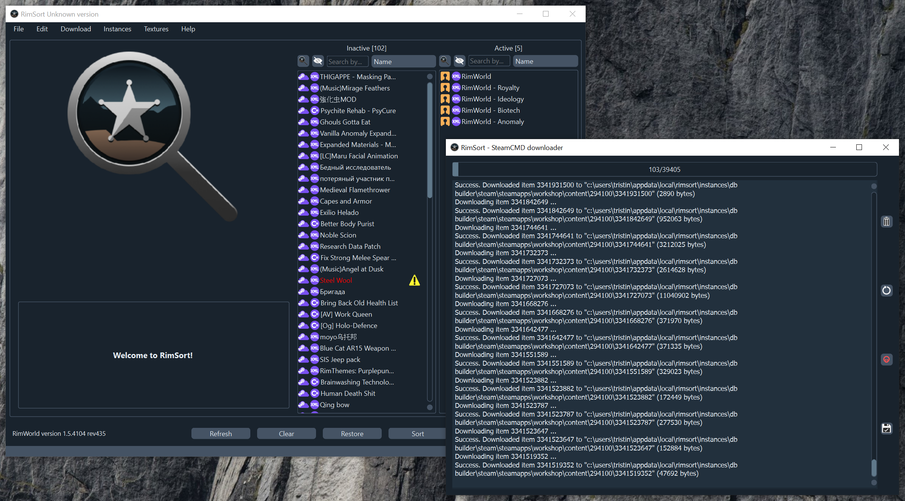

<p align="center">
    <h1 align="center">RimSort</h1>
    <p align="center">A free and open source multi-platform mod manager for the video game RimWorld.<br>
    Built from the ground up to be reliable and community managed.<br>
    Includes support for Linux, Mac, and Windows.</p>
    <p align="center"><strong><a href="https://github.com/RimSort/RimSort/releases">Releases</a> | <a href="https://rimsort.github.io/RimSort/">Wiki</a> | <a href="https://discord.gg/aV7g69JmR2">Discord</a></strong> </p>
    <p align="center">
        <a href="https://codecov.io/gh/RimSort/RimSort"></a>
    </p>
    <br><br><br>
</p>



## Installation

To install RimSort, visit the [Releases][Releases] page and download the latest zipped release for your operating system.

For Windows and Linux, unzip the download and run the `RimSort` executable inside the unzipped folder.

For macOS, grab the `arm64` release (Apple silicon). Intel (`x86_64`) Macs are no longer supported: `cryptography` stopped publishing x86_64 macOS wheels in 49.0.0, and pinning a security-critical dependency to an unsupported release isn't a trade we want to make. The last Intel build is still downloadable from the [Releases][Releases] page. You may need to follow [special instructions](https://rimsort.github.io/RimSort/user-guide/downloading-and-installing#macos) to get around Gatekeeper errors.

Check the [wiki][Wiki] for more detailed instructions.

### Nix

RimSort ships a Nix flake (Linux). It builds the app from `uv.lock`, so the packaged app runs the exact locked dependencies:

```sh
nix run github:RimSort/RimSort#rimsort   # run the packaged app
nix build github:RimSort/RimSort#rimsort # build only
```

NixOS and home-manager configurations can add `overlays.default` to `nixpkgs.overlays` and install `pkgs.rimsort`; it is built from the flake's pinned nixpkgs, which already allows the bundled Steamworks SDK. Without flakes, `nix-build` and `nix-shell` work through `default.nix` / `shell.nix`.

For development, the flake provides a pure shell with the locked dev environment (pytest, mypy, pyright, ruff) and auto-installed pre-commit hooks (skipped when `just install-hooks` set `core.hooksPath`). The `just` recipes and `uv run` use the Nix environment inside it:

```sh
nix develop
just test
```

With [direnv](https://direnv.net/) (and ideally [nix-direnv](https://github.com/nix-community/nix-direnv)), `direnv allow` loads the shell automatically when Nix is installed and falls back to the uv `.venv` otherwise; set `RIMSORT_NO_NIX=1` or use `.envrc.local` to opt out.

See `flake.nix` and `nix/parts/` for the plumbing.

## Conflict analysis (source development)

In a source checkout configured with the compatible native conflict detector,
choose **View → Analyze Mod Conflicts** to scan the current active list in
its displayed order, including unsaved changes. The report is best effort:
no findings do not prove that the mod list is conflict-free. Review the
findings and scan diagnostics; the summary shows the number of parsed mods and
mods involved in conflicts, distinct from the snapshot's usable input count.
The findings view opens on the highest non-empty severity bucket (errors,
otherwise warnings, otherwise info). You can then combine severity toggles,
a target search, a finding-type selector, and the affected-mod sidebar without
rerunning the detector. The sidebar lists only mods that participate in
reported findings and shows report-wide error/warning/info counts per mod;
those counts are not additive because one finding can involve several mods.
Selecting a finding opens a structured inspector with translated severity,
target, mechanism, participant mod actions, and reported outcome details.
Technical details are built only when their collapsed section is opened for
the selected finding; raw finding data has a separate lazy disclosure.
Reset filters clears the
mod/text/type filters and restores that initial severity choice.
Scan notes live on their own tab and show a scan-wide attention count even for
complete scans. The notes tab is independent from the current finding filters;
ordinary informational diagnostics stay available there without changing the
incomplete or stale status, and additional raw note data also stays behind an
explicit disclosure.
An incomplete result means input or analysis was skipped or degraded. A stale
result means the active snapshot may have changed; run the analysis again.
Changes on disk may not always be detected. If the game version is unknown,
version-specific content may be skipped and the result is marked incomplete.
Known native diagnostic codes use translatable templates; unknown codes fall
back to the native message, and embedded error details may remain untranslated.

The scan runs in a separate worker. Use **Cancel scan** or close the dialog to
request cancellation; termination may take time, and cancellation does not
produce a completed report. Inputs and reports have no application-defined
size caps: large XML files, managed assemblies, or many findings can consume
substantial memory or exhaust it, including in the RimSort process.

For Linux source development, build the compatible detector checkout's debug
FFI library and supply its absolute path before starting RimSort:

```sh
cd /path/to/rimworld-conflict-detector
cargo build --locked -p rcd-ffi
cd /path/to/RimSort
RIMSORT_DEV=1 RIMSORT_RCD_LIBRARY=/absolute/path/to/rimworld-conflict-detector/target/debug/librcd_ffi.so uv run python -m app
```

The override is for uncompiled development mode only; the library must match
the integration's expected FFI and report schema. A missing or unloadable
library causes the scan to fail. Bundling and packaged distribution of this
integration are not yet supported or verified; the existing release and Nix
installation instructions above do not imply that they include the detector.

## Contributing

Bugs and feature requests are tracked in the [Issues][Issues] section of this repo. If you run into a bug or have a feature suggestion, feel free to create an Issue here yourself!

See the [wiki][Wiki] for detailed instructions on building RimSort yourself as well as guidelines for making pull requests.

Interested in helping translate RimSort to your language? Check out our [Translation Guidelines](https://rimsort.github.io/RimSort/development-guide/translation-guidelines) for detailed instructions on how to contribute translations.

## FAQ and Issues

If you have an issue, make sure you **checked the [wiki][Wiki]** for a solution.

[][Discord]

## Credits

- "Update" icon by [Icons8](https://icons8.com) ([icon link](https://icons8.com/icon/aPgBhcyogqyV/update)).

[Wiki]: https://rimsort.github.io/RimSort/
[Issues]: https://github.com/RimSort/RimSort/issues
[Releases]: https://github.com/RimSort/RimSort/releases
[Discord]: https://discord.gg/aV7g69JmR2
